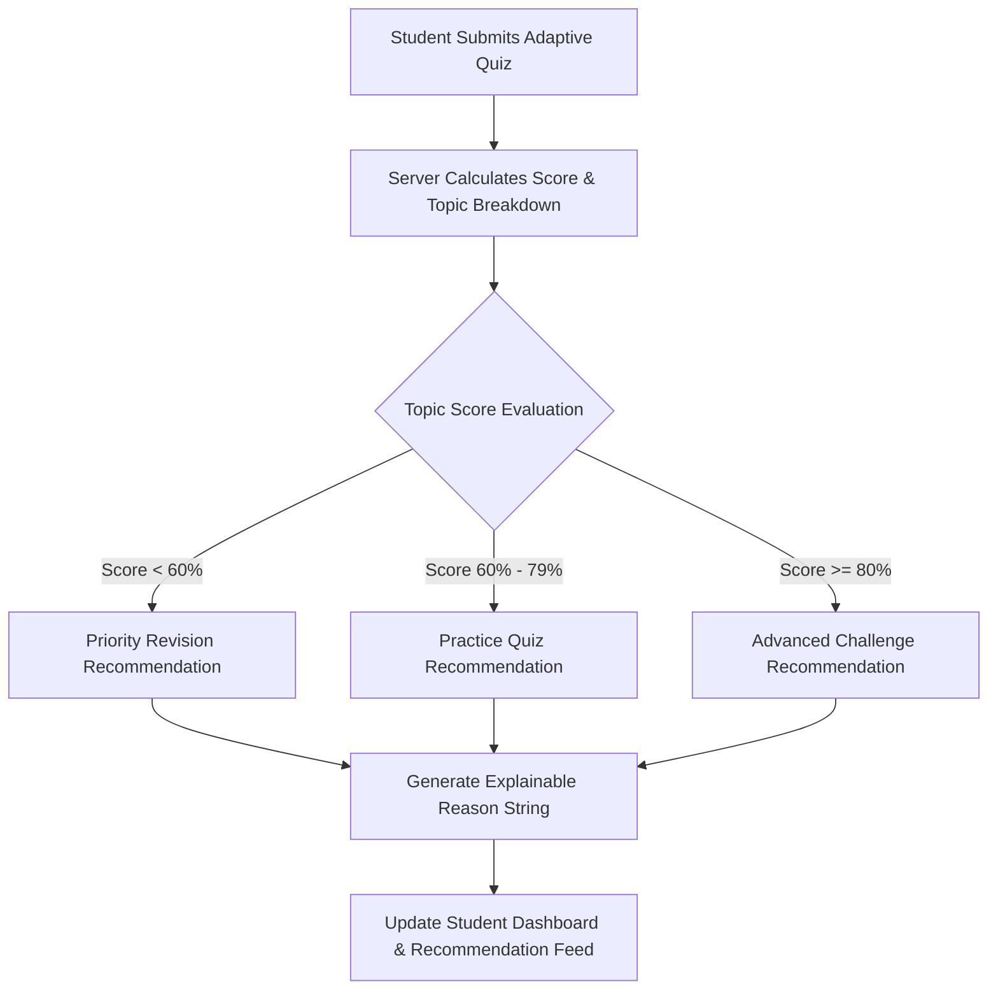

# Learnora — AI-Powered Personalized Learning Management System

> **Official Tagline:** Learn &bull; Grow &bull; Achieve  
> **Brand Name:** Learnora  
> **College Major Project Edition**

---

## 1. Project Overview

**Learnora** is a modern, responsive, full-stack educational web application and AI-powered Personalized Learning Management System (LMS). Traditional learning platforms deliver the exact same linear curriculum to all students regardless of individual comprehension. Learnora revolutionizes this model by actively assessing student knowledge through adaptive diagnostic quizzes, pinpointing topic-wise proficiencies and misconceptions, and dynamically recommending tailored lessons, revision materials, and practice challenges.

### Core Philosophy
* **Adaptive Diagnostic Engine:** Evaluates student retention at the granular topic level.
* **Explainable Recommendations:** Transparently explains *why* each lesson or quiz is recommended (e.g., *"Recommended because your Database Fundamentals quiz score was 50%"*).
* **Guaranteed Server Evaluation:** All assessment scores and topic performance analytics are computed on the backend against authoritative answer keys, preventing client tampering.
* **Dual Persistence Engine:** Seamlessly connects to MongoDB via Mongoose when available, while providing an automatic, persistent in-memory / state engine fallback for environments without an active MongoDB daemon.

---

## 2. Problem Statement

Standard Learning Management Systems present static syllabi with universal pacing. Fast learners face boredom with repetitive exercises, while students who struggle with foundational concepts are forced forward without remediating core deficits.

**Learnora solves this by:**
1. Transforming quizzes from static gatekeepers into continuous diagnostic probes.
2. Segmenting performance by topic (e.g., *Syntax*, *Control Flow*, *Query Optimization*).
3. Applying explainable rule-based algorithms to recommend:
   - **Score < 60%:** Beginner foundational lessons and revision materials.
   - **Score 60% – 79%:** Targeted skill-building practice quizzes.
   - **Score ≥ 80%:** Advanced lessons and engineering challenges.
4. Keeping students motivated with real-time progress indicators, streak counters, and weekly learning velocity metrics.

---

## 3. Technology Stack

### Frontend
- **Framework:** React.js (v19) with Vite
- **Language:** Modern JavaScript (ES6+)
- **Styling:** Custom CSS3 Design System with CSS variables
- **Color Identity:** Pastel productivity palette (Pale blue `#EAF5FC`, Navy `#1E3A5F`, Sky blue `#38BDF8`, Peach `#FDBA9A`, Blush pink `#F7DCE3`, Soft yellow `#F9E4AF`, Lavender `#E4DFF5`). **Strictly zero green.**
- **Icons:** Lucide React
- **Data Visualization:** Recharts
- **Routing:** React Router v7

### Backend
- **Runtime:** Node.js (v24+)
- **Web Framework:** Express.js (v4)
- **Database & ODM:** MongoDB with Mongoose (with automated local development state fallback)
- **Authentication:** JSON Web Tokens (JWT) & bcryptjs password hashing
- **CORS & Middleware:** Centralized error handling, role-based authorization guards

---

## 4. UI/UX Design System & Color Palette

Learnora uses a soothing, welcoming educational aesthetic inspired by modern pastel productivity applications:

| Element | Hex Code | Purpose |
|---|---|---|
| **Main Page Background** | `#EAF5FC` | Soft pale blue canvas with subtle radial decorative glows |
| **Main Content Panels** | `#FFFDF9` | Warm-white elevated panels with rounded corners |
| **Primary Headings & Text** | `#1E3A5F` | High-contrast, readable navy typography |
| **Pastel Blue Cards** | `#DDEFFA` | Course cards, information alerts, and status pills |
| **Blush Pink Cards** | `#F7DCE3` | Revision alerts, diagnostic focus areas, and urgent notices |
| **Soft Yellow Cards** | `#F9E4AF` | Practice quizzes, upcoming milestones, and study schedules |
| **Lavender Cards** | `#E4DFF5` | Advanced challenge tracks and instructor console chips |
| **White Cards** | `#FFFFFF` | Syllabus modules, lesson cards, and solution keys |
| **Sky Blue Accents** | `#38BDF8` | Primary active badges, highlights, and completion fills |
| **Peach Accents** | `#FDBA9A` | Secondary accents, streak counters, and focal points |

> **Strict Color Policy:** Learnora strictly avoids green, sage, mint, olive, or teal across all UI elements, charts, buttons, and badges.

---

## 5. Architectural Overview

```
                          ┌───────────────────────────┐
                          │   Learnora Frontend       │
                          │   (React + Vite on :3000) │
                          └─────────────┬─────────────┘
                                        │ REST / JWT
                                        ▼
                          ┌───────────────────────────┐
                          │    Express.js Backend     │
                          │    (Node.js on :5000)     │
                          └─────────────┬─────────────┘
                                        │
                ┌───────────────────────┴───────────────────────┐
                ▼                                               ▼
   ┌──────────────────────────┐                    ┌──────────────────────────┐
   │    MongoDB / Mongoose    │                    │  Local Development Mode  │
   │   (When MONGODB_URI is   │                    │ (Automatic runtime state │
   │   available and online)  │                    │ engine if DB is offline) │
   └──────────────────────────┘                    └──────────────────────────┘
```

### Recommendation Engine Logic


---

## 6. Project Folder Structure

```
LMS/
├── backend/
│   ├── config/
│   │   └── db.js                 # MongoDB connection with graceful state fallback
│   ├── controllers/
│   │   ├── analyticsController.js# Student & instructor performance metrics
│   │   ├── authController.js     # User registration, login, token issuance
│   │   ├── courseController.js   # Course CRUD, filtering, enrollments
│   │   ├── lessonController.js   # Lesson retrieval & completion tracking
│   │   ├── quizController.js     # Server-side quiz evaluation & attempt recording
│   │   └── recommendationController.js # Recommendation engine dispatcher
│   ├── middleware/
│   │   ├── auth.js               # JWT verification middleware
│   │   └── role.js               # Role-based access control (Student / Instructor)
│   ├── models/
│   │   ├── Course.js
│   │   ├── Enrollment.js
│   │   ├── Lesson.js
│   │   ├── LessonProgress.js
│   │   ├── Quiz.js
│   │   ├── QuizAttempt.js
│   │   └── User.js
│   ├── routes/
│   │   ├── analyticsRoutes.js
│   │   ├── authRoutes.js
│   │   ├── courseRoutes.js
│   │   ├── lessonRoutes.js
│   │   ├── quizRoutes.js
│   │   └── recommendationRoutes.js
│   ├── seed/
│   │   ├── seedData.js           # 4 complete courses, lessons, quizzes, & users
│   │   └── seedRunner.js         # Dedicated CLI MongoDB seeder
│   ├── services/
│   │   ├── dataStore.js          # Unified data interface (Mongoose + local store)
│   │   └── recommendationEngine.js # Explainable rule-based AI engine
│   ├── .env                      # Environment configuration
│   ├── .env.example              # Template environment variables
│   ├── package.json
│   └── server.js                 # Express server entry point
├── frontend/
│   ├── public/
│   │   ├── favicon.png           # Learnora favicon icon
│   │   └── learnora-logo.png     # Official high-res brand logo (Navy, Sky, Peach)
│   ├── src/
│   │   ├── api/
│   │   │   └── client.js         # Centralized API wrapper with token injection
│   │   ├── components/
│   │   │   ├── Footer.jsx        # Branded footer with tagline
│   │   │   ├── Modal.jsx         # Accessible modal dialog
│   │   │   ├── Navbar.jsx        # Branded navigation header
│   │   │   ├── RecommendationCard.jsx # Explainable suggestion card
│   │   │   ├── Sidebar.jsx       # Student & instructor portal navigation
│   │   │   └── StatCard.jsx      # Pastel KPI metric cards
│   │   ├── context/
│   │   │   └── AuthContext.jsx   # Global session state & demo helpers
│   │   ├── pages/
│   │   │   ├── AdaptiveQuizPage.jsx      # One-by-one question quiz runner
│   │   │   ├── CourseCatalogue.jsx       # Course catalog with search & filters
│   │   │   ├── CourseDetail.jsx          # Detailed course syllabus overview
│   │   │   ├── CourseLearningPage.jsx    # Lesson viewer & completion runner
│   │   │   ├── InstructorDashboard.jsx   # Faculty management portal
│   │   │   ├── LandingPage.jsx           # Public hero page with tagline & preview
│   │   │   ├── LoginPage.jsx             # Secure login with demo quick-fills
│   │   │   ├── ProgressAnalyticsPage.jsx # Diagnostic charts & performance history
│   │   │   ├── RecommendationsPage.jsx   # Full adaptive recommendation feed
│   │   │   └── RegisterPage.jsx          # Student / Instructor registration
│   │   ├── App.jsx               # Protected client routing
│   │   ├── index.css             # Master design system & CSS variables
│   │   └── main.jsx              # React DOM mounting
│   ├── index.html
│   ├── package.json
│   └── vite.config.js            # Vite build configuration with API proxy
└── README.md
```

---

## 7. Prerequisites

Before running Learnora, ensure you have the following installed on your machine:
- **Node.js:** v18.0.0 or later (v24 recommended)
- **npm:** v9.0.0 or later
- **Operating System:** Windows 10/11, macOS, or Linux
- **MongoDB (Optional):** Local MongoDB Community Edition or MongoDB Atlas connection string. If MongoDB is not installed, Learnora automatically runs in **Local Development Mode** with full persistence!

---

## 8. Quick Start Guide (Windows)

Open two terminal windows (PowerShell or Command Prompt).

### Terminal 1: Backend Server

```powershell
# 1. Navigate to the backend directory
cd "C:\Users\Chandana Shree\OneDrive\Desktop\LMS\backend"

# 2. Install dependencies (if not already installed)
npm install

# 3. Start the Express API server
node server.js
```

The backend starts on `http://localhost:5000`. You will see:
```
====================================================
  LEARNORA — AI-Powered Personalized LMS API
  Tagline: Learn  Grow  Achieve
  Port: 5000
  Storage Mode: Local Development Mode (In-Memory / State Engine)
====================================================
```

### Terminal 2: Frontend Client

```powershell
# 1. Navigate to the frontend directory
cd "C:\Users\Chandana Shree\OneDrive\Desktop\LMS\frontend"

# 2. Install dependencies (if not already installed)
npm install

# 3. Start the Vite development server
npm run dev
```

Open your browser at:  
👉 **`http://localhost:3000`** (or the port displayed in your terminal).

---

## 9. Development Demo Credentials

For quick testing during college presentations and project evaluations, the Login page includes one-click **"Demo Student"** and **"Demo Instructor"** buttons. Alternatively, you can enter:

### Student Account
- **Email:** `student@learnora.edu`
- **Password:** `Student@123`
- **Permissions:** View dashboard, take quizzes, complete lessons, view personalized recommendations, analyze progress.

### Instructor Account
- **Email:** `instructor@learnora.edu`
- **Password:** `Instructor@123`
- **Permissions:** Create/edit/delete courses, add lessons, author multiple-choice quizzes, view enrolled students and class analytics.

---

## 10. Complete College Major Project Demonstration Flow

Follow this exact 8-step sequence to demonstrate the adaptive system in action:

1. **Visit Landing Page (`/`):**
   - Observe the Learnora logo, the tagline *"Learn &bull; Grow &bull; Achieve"*, and the hero heading *"Learn Smarter. Grow at Your Pace."*
   - Review the adaptive engine preview and feature highlights.
2. **Log In as Student (`/login`):**
   - Click **"Demo Student"** and click **Sign In**.
   - Notice the greeting, total enrolled courses, average score, and initial recommendations.
3. **Open Course Learning Syllabus (`/learn/course_python_101`):**
   - Read the lesson *"Variables, Types, and Memory in Python"*.
   - Click **"Mark as Completed"** — observe the progress percentage bar increase instantly.
4. **Take an Adaptive Diagnostic Quiz (`/quiz/quiz_py_01`):**
   - Answer the 4 multiple-choice questions one by one with the progress bar.
   - Click **"Submit Quiz Evaluation"** and confirm.
5. **Inspect Server-Side Grading Results:**
   - Review the percentage score, question solution key, and detailed explanations.
   - Notice that correct answers are highlighted in **Sky Blue** (`#38BDF8`), strictly avoiding green.
6. **Observe Dynamic AI Recommendations (`/recommendations`):**
   - Inspect the updated suggestions. Notice the explainable reasons:
     - *"Recommended because your Database Fundamentals quiz score was 50%. Reinforce the fundamentals before retrying."*
     - *"Recommended because your Python Basics quiz score was 100%. You have mastered the basics and are ready for advanced topics!"*
7. **Inspect Analytics Dashboard (`/analytics`):**
   - Examine topic-wise mastery bars, chronological score trajectory, verified topic strengths, and focus areas.
8. **Switch to Instructor Hub (`/instructor`):**
   - Sign out and log in with the **"Demo Instructor"** button.
   - View class completion statistics, student quiz submissions, and create a new course using the **"Create New Course"** modal form.

---

## 11. REST API Specification

| Method | Endpoint | Protection | Description |
|---|---|---|---|
| `GET` | `/api/health` | Public | System status, brand check, active storage mode |
| `POST` | `/api/auth/register` | Public | Register new student or instructor |
| `POST` | `/api/auth/login` | Public | Authenticate user & return JWT token |
| `GET` | `/api/auth/me` | Bearer Token | Fetch authenticated user profile |
| `GET` | `/api/courses` | Public | List courses with search & category filters |
| `GET` | `/api/courses/:id` | Optional Auth | Detailed course syllabus with progress |
| `POST` | `/api/courses/enroll` | Student | Enroll authenticated student in course |
| `POST` | `/api/courses` | Instructor | Create new course module |
| `DELETE` | `/api/courses/:id` | Instructor | Delete course and related syllabus |
| `POST` | `/api/lessons/:id/complete`| Student | Mark lesson completed & update progress |
| `POST` | `/api/lessons` | Instructor | Add new lesson to course syllabus |
| `GET` | `/api/quizzes/:id` | Student | Fetch quiz questions for taking |
| `POST` | `/api/quizzes/:id/submit` | Student | Authoritative server grading & attempt save |
| `GET` | `/api/recommendations` | Student | Rule-based personalized recommendations |
| `GET` | `/api/analytics/student` | Student | Student diagnostic mastery & score history |
| `GET` | `/api/analytics/instructor` | Instructor | Class analytics & student attempt audit |

---

## 12. MongoDB Setup & Seed Data (Optional)

If you have a local MongoDB daemon installed and wish to seed data directly into MongoDB:

1. Ensure MongoDB service is running:
   ```powershell
   net start MongoDB
   ```
2. Run the seed script:
   ```powershell
   cd backend
   npm run seed
   ```
3. Restart the backend server (`node server.js`). It will automatically output:
   `[Learnora Backend] MongoDB Connected: 127.0.0.1`

---

## 13. Limitations and Future Enhancements

- **NLP Question Generation:** Integrate Large Language Models (LLMs) to automatically generate new multiple-choice questions from lesson text.
- **Peer Discussion Forums:** Add threaded discussion boards per lesson with instructor moderation.
- **Spaced Repetition Flashcards:** Integrate Leitner box scheduling for long-term memory retention.
- **WebSocket Live Notifications:** Push real-time study streak reminders and instructor course updates.

---

## 14. License & Attribution

Developed for academic presentation and college major project evaluation.  
Official Brand: **Learnora**  
Tagline: **Learn &bull; Grow &bull; Achieve**
